# 掼蛋牌力评估 · 用户手册

> 适用版本：App 1.0，评分规则 V4.2（2026-10-31）
> 运行平台：Android 8.0（API 26）及以上，锁定竖屏
> 手册截图：HUAWEI LIO-N29，Android 10，1176 × 2400，字体缩放 1.0

「掼蛋牌力」把一手牌变成可比较的量化指标：拍照、相册导入或逐张补录 1～27 张牌，核对无误后选择本局级牌，应用会搜索当前手牌的最优拆牌，并给出 **SPI / NSPI、评级、阶段、散牌惩罚和逐组牌型明细**。需要按自己的思路调整时，可以进入「手工拆牌」；27 张手牌还能把拆牌方案导出成图片。

它评估的是**这一手牌本身的牌力**，不预测胜率，也不考虑对手手牌、座次和出牌顺序。

---

## 1. 安装与首次启动

1. 准备一台 Android 8.0 及以上的手机。
2. 安装调试包（开发/内测阶段）：

   ```bash
   adb install -r -t app/build/outputs/apk/debug/app-debug.apk
   ```

   也可以直接把 `app-debug.apk` 传到手机，用文件管理器打开安装；系统提示「未知来源」时需临时允许该来源。
3. 在桌面找到「掼蛋牌力」并打开。首次启动**不需要登录**，也不强制配置 AI。
4. 点「拍照」时才会申请相机权限；拒绝后仍可用「相册」或「随机生成 27 张」。
5. 联网识图需要网络；本地识牌、拆牌和评分都在手机本地完成。

主界面从上到下固定为四个分区：

| 分区 | 作用 |
| --- | --- |
| 01 输入手牌 | 拍照、相册、随机生成 27 张、保存当前图片 |
| 02 识别 | 本地识牌状态、当前 AI 源、联网识图 |
| 03 核对手牌 | 牌面校正、删除、补录、张数统计 |
| 04 综合牌力 | 级牌选择、计算按钮、结果卡与拆牌明细 |

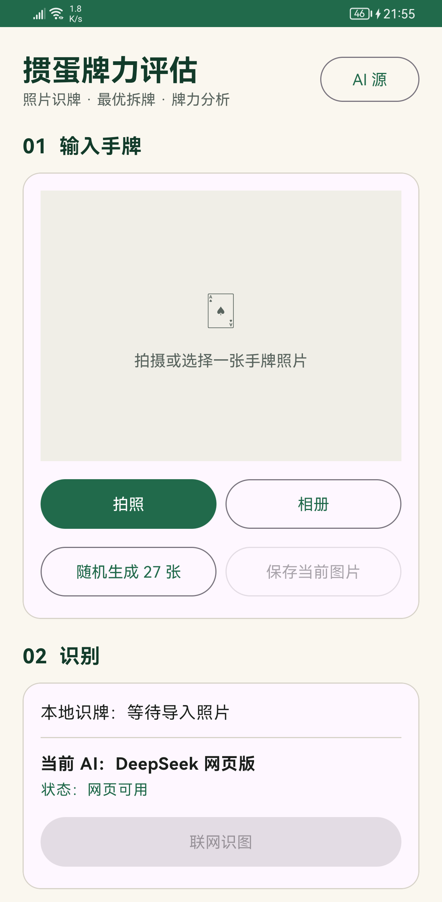

*图 1　首次进入：01 输入手牌为空状态，02 识别等待导入照片，联网识图在无图时不可点。*

---

## 2. 五分钟快速上手（随机手牌）

想先看完整效果，用随机手牌最快：

1. 在「01 输入手牌」点 **随机生成 27 张**。
2. 应用会立刻生成一张 27 张手牌示意图，并把 27 张牌填入核对区；「本地识牌」显示「已识别 27 张，请核对」。
3. 向下滚动到「03 核对手牌」，确认 `27 / 27` 和牌面。
4. 在「本局级牌」下拉框选择本局打几（2～A）。
5. 点 **计算综合牌力**，等待「正在寻找最优拆牌…」结束。
6. 在「04 综合牌力」查看评级、SPI、NSPI、评分分子、轮数、`T_max`、阶段和散牌惩罚。
7. 点 **查看逐组拆牌明细** 展开每组牌型与分值；需要调整时点 **手工拆牌**。
8. 27 张时点 **生成并保存最优拆牌图**，图片会写入相册 `Pictures/GuanDanScore/`。

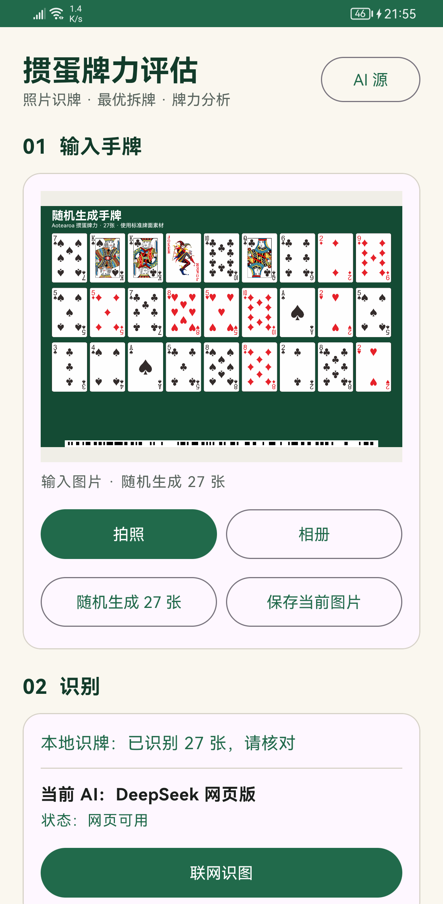

*图 2　随机手牌：自动生成示意图并填入 27 张，不会上传任何图片。*

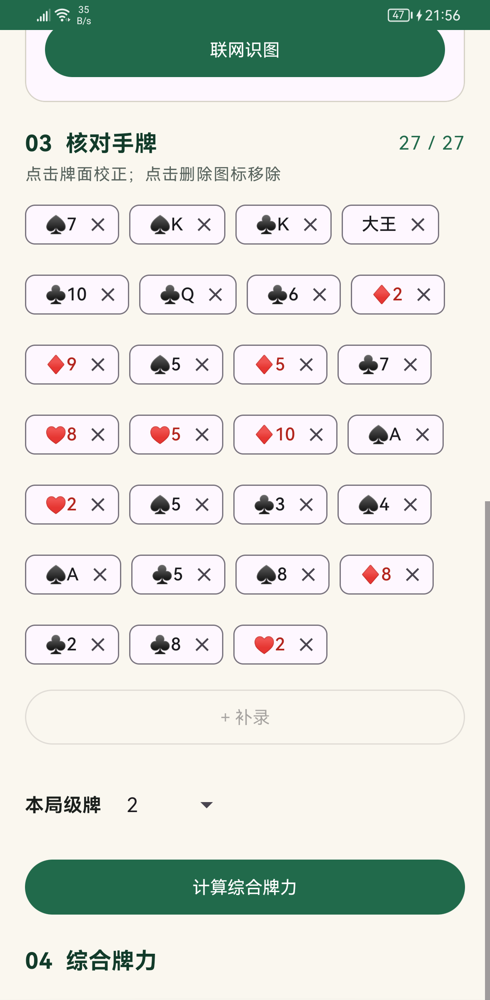

*图 3　03 核对手牌：`27 / 27` 表示已满；点击任一张可校正，点 `×` 删除；下方选择本局级牌。*

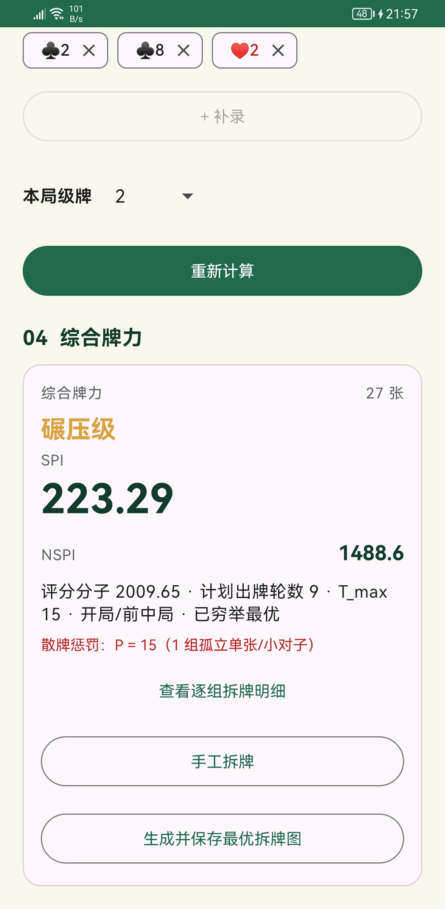

*图 4　结果卡：评级、SPI、NSPI、评分分子、计划轮数、`T_max`、阶段、最优性和散牌惩罚集中展示。*

> 图中的 223.29 / 1488.6 等数字来自一次随机手牌，仅用于说明字段位置，不是评级阈值，也不代表典型手牌。

---

## 3. 详细操作步骤

### 3.1 导入手牌照片

有三个入口，任选其一：

**拍照**

1. 点 **拍照**。
2. 首次使用允许相机权限；拒绝会提示「需要相机权限才能拍照」，可改用相册。
3. 让整手牌完整落在取景框内，尽量正对、光线均匀，避免牌角被手指或相邻牌遮挡。
4. 拍摄后自动返回应用并开始本地识别。

**从相册选择**

1. 点 **相册**。
2. 在系统图片选择器中选择一张手牌照片。
3. 图片读取失败时，界面显示「图片读取失败：原因」，已有手牌不会被清空，可以重新选择。

**随机生成（演示/练习）**

- 点 **随机生成 27 张** 会生成标准牌面示意图，并直接得到 27 张手牌，适合熟悉流程。
- 它不会调用识别，也不会上传图片。

导入后，「保存当前图片」才可用；它保存的是**当前输入图**，与后面的拆牌图是两回事。

### 3.2 本地识牌（自动、离线）

图片导入后自动开始，不需要再点按钮。状态会依次变化：

| 状态 | 含义 |
| --- | --- |
| 本地识牌：正在识别手牌… | 正在处理 |
| 本地识牌：已识别 N 张，请核对 | 识别完成，仍需人工核对 |
| 本地识牌：识别 N 张，有 K 条警告 | 部分不确定，下方列出警告 |
| 本地识牌失败：原因 | 无法识别，可换图或手动补录 |

- 本地识别完全离线，图片不会离开手机。
- 识别遵守两副牌的限制：同一点数 + 花色最多 2 张。
- 花色识别依赖点数下方的小图形投票，低置信度会写进警告；**警告不是错误，但相关牌一定要核对**。
- 被遮挡的牌不可能凭空恢复，请用「+ 补录」补上。

### 3.3 联网识图（可选）

本地识别不理想，或想用大模型再读一遍时使用。联网识图由用户主动触发，会把当前图片发送到所选 AI 源。

1. 确认已导入图片；无图时「联网识图」按钮不可点。
2. 确认「02 识别」中的 **当前 AI** 与状态。状态为「网页可用」可直接识图；「需要登录」时点右侧 **登录**。
3. 点 **联网识图**，按钮上方显示「正在通过 XXX 识图…」。
4. 成功后显示「XXX 识别：N/27 张，请核对」，并用识别结果替换当前手牌，同时清除旧评分。
5. 失败时按类别提示，例如「识图失败（需要登录）」「（回答超时）」「（解析失败）」「上传额度已用尽」，不会笼统报「网络错误」。

**HTTP API 源未填 API Key** 时，点联网识图会提示「HTTP API 源需要填写 API Key」，并自动打开 AI 源管理页。

AI 源的添加、登录、切换与健康检查见第 4 节。

### 3.4 核对手牌

「03 核对手牌」显示当前张数（如 `27 / 27`）和全部牌面。**识别结果必须核对后再计算。**

**校正一张牌**

1. 点要修改的牌面 Chip。
2. 在「校正扑克牌」对话框中选择点数和花色。
3. 点 **保存**；点 **取消** 不修改。

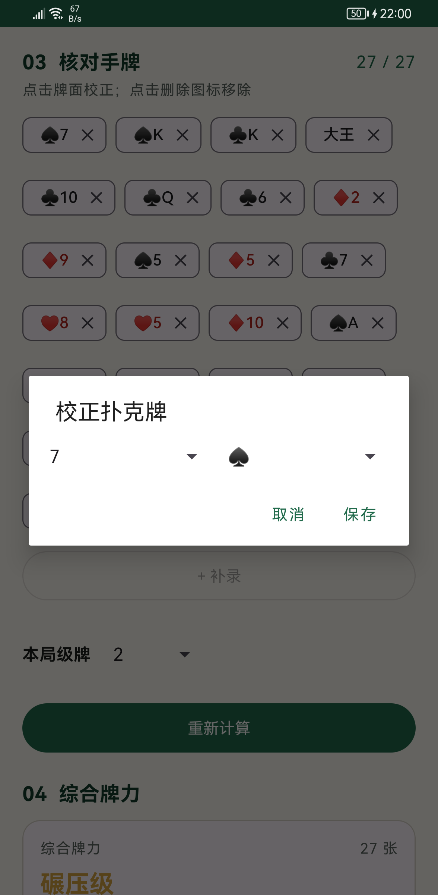

*图 5　校正对话框：左侧点数、右侧花色；选大王/小王时花色自动锁定为「王」。*

**删除一张牌**

- 点牌面右侧的 `×`。张数立即减一，旧评分标记为需要重新计算。

**补录一张牌**

1. 点 **+ 补录**。
2. 在「补录扑克牌」对话框选择点数与花色，点 **保存**。
3. 最多 27 张；已满时补录按钮不可用，强行保存会提示「已有 27 张牌」。

**张数与合法性**

- 支持 1～27 张：不足 27 张也能计算，只是不能生成拆牌图。
- 同一张牌（点数 + 花色）最多出现 2 次；出现第 3 张时计算会失败并提示「两副牌中同一张牌最多出现 2 次」。
- 手牌或级牌一旦改变，旧结果会显示「手牌或级牌已改变，需要重新计算」，手工拆牌入口同时禁用，避免拿旧结果继续操作。

### 3.5 选择本局级牌

- 在「本局级牌」下拉框选择 2、3、…、10、J、Q、K、A。
- 级牌影响单张/对子/三张的取值、红心配的使用方式和炸弹的替代点数，**必须与本局实际级牌一致**。
- 改变级牌会让旧结果失效，需要重新计算。

### 3.6 计算综合牌力

1. 确认手牌张数在 1～27 之间。
2. 点 **计算综合牌力**（已有结果时按钮变为 **重新计算**）。
3. 等待「正在寻找最优拆牌…」。搜索有 15 秒总预算，多数手牌会提前完成。
4. 完成后出现「04 综合牌力」结果卡；失败会显示「计算失败：原因」。

结果会标注最优性：

- **已穷举最优**：在预算内完成了精确搜索。
- **近似最优**：预算内未穷举完，返回的是完整合法的近似最优解，仍可直接使用。

### 3.7 读懂结果卡

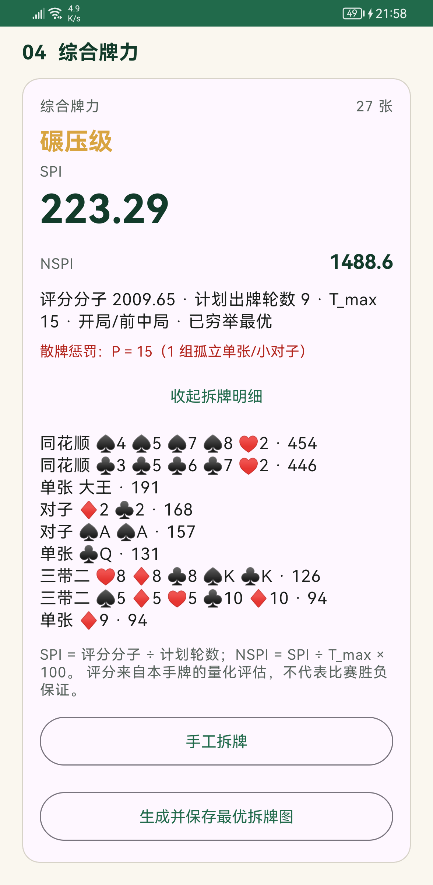

*图 6　展开后的逐组拆牌明细，按牌型分值从高到低排列。*

| 字段 | 说明 |
| --- | --- |
| 评级 | 弱势 / 均衡 / 强势 / 碾压级；部分张数显示「待标定」 |
| `SPI` | 综合牌力指数 =（Σ 牌型分值 × 控制力系数 − 散牌惩罚）÷ 计划轮数 |
| `NSPI` | `SPI ÷ T_max(N) × 100`，把不同张数放到同一尺度；27 张时 `T_max = 15` |
| 综合牌力 N 张 | 本次参与计算的手牌张数 |
| 评分分子 | 控制加权和扣除散牌惩罚后的分子 |
| 计划出牌轮数 | 当前最优方案的出牌单元数 |
| `T_max` | 当前张数对应的理论最少轮数基准 |
| 阶段 | 19～27 张「开局/前中局」、10～18 张「中局」、1～9 张「残局」 |
| 已穷举最优 / 近似最优 / 手工拆牌 | 当前结果的来源 |
| 散牌惩罚 | 仅当存在孤立单张/小对子时显示：`P = 15 × 组数` |
| 残局控制覆盖比 | 仅残局显示：`R = 控制单元 ÷ (T_plan − 1)`；`T_plan = 1` 时改显示「单次出牌方案」 |

**评级阈值**（与规则文档一致）：

| 阶段 | 弱势 | 均衡 | 强势 | 碾压级 |
| --- | --- | --- | --- | --- |
| 残局 1～9 张（辅助参考） | SPI < 60 | 60 ≤ SPI < 120 | 120 ≤ SPI < 180 | SPI ≥ 180 |
| 中局 13～18 张 | SPI < 70 | 70 ≤ SPI < 130 | 130 ≤ SPI < 200 | SPI ≥ 200 |
| 27 张 | SPI < 80 | 80 ≤ SPI < 140 | 140 ≤ SPI < 220 | SPI ≥ 220 |

- **10～12 张、19～26 张暂无阈值依据**，可以算 SPI，但评级显示「待标定」，不会外推到相邻区间。
- 散牌惩罚按出牌单元计数，1～27 张统一适用，没有残局豁免。
- 明细按分值降序，每组显示牌型、真实牌面和分值；点 **收起拆牌明细** 可折叠。

### 3.8 手工拆牌

对最优方案有不同想法时使用（例如想保留某个炸弹、或按实战习惯重排）。

1. 在结果卡点 **手工拆牌**。该入口只在 2～27 张时出现；1 张牌无需拆牌。
2. 页面顶部并排显示「最优拆牌」和「手工拆牌」的评级、SPI、NSPI、分子、轮数，下方给出差值（如「较最优 −52.06 · 多 3 轮」）。
3. 每组一行；**勾选两组及以上** 后点 **合并所选**：
   - 只有一种合法合并时直接合并；
   - 有多种时弹出「选择合并后的牌型」；
   - 无法组成合法牌型时按钮禁用并提示。
4. 点任意分组行可 **改判**（同花顺→顺子等）或 **拆成单张**；行尾 **拆分** 还提供「拆成基础组」。
5. **撤销** 回退上一步；**重置** 需二次确认，回到进入页面时的分区。
6. 点 **应用结果** 返回主界面。返回键在存在未保存修改时会询问：
   - **保留并返回**：等价于应用当前分区并返回；
   - **放弃**：丢弃本次修改。
7. 应用后主界面来源行显示「手工拆牌 · 最优 X → Y（较最优 …）」，可点 **查看最优拆牌** 只读对照，或点 **恢复最优方案** 一键还原。

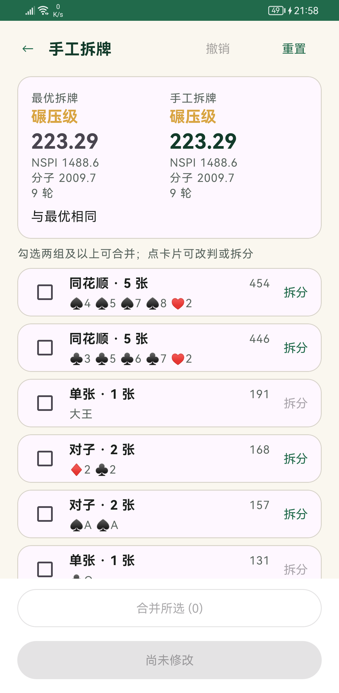

*图 7　手工拆牌：左列只读最优，右列随编辑实时更新；底部固定「合并所选」与「应用结果」。*

### 3.9 保存图片

| 按钮 | 前提 | 结果 |
| --- | --- | --- |
| 保存当前图片 | 已导入/生成输入图 | 保存输入图到相册 |
| 生成并保存最优拆牌图 | 当前结果存在且为 27 张 | 生成按牌型分列、分值降序的拆牌图并保存 |
| 生成并保存手工拆牌图 | 当前结果是手工拆牌且为 27 张 | 同上，标签改为手工方案 |

- 不足 27 张时按钮禁用，文案显示「需 27 张手牌才能生成拆牌图」。
- 文件写入 `Pictures/GuanDanScore/`，文件名形如 `guandan-最优拆牌图-<时间戳>.png`。
- 成功提示「已保存到相册：文件名」；失败保留已有结果，并显示失败原因。
- 手牌、级牌或拆牌方案改变后，旧的拆牌图不再对应当前结果，需要重新生成。

---

## 4. AI 源管理（联网识图）

从主界面右上角 **AI 源** 进入。页面自上而下为：当前使用、1 选择 AI 源、2 配置档、3 配置；底部固定 **取消 / 保存并选用**。

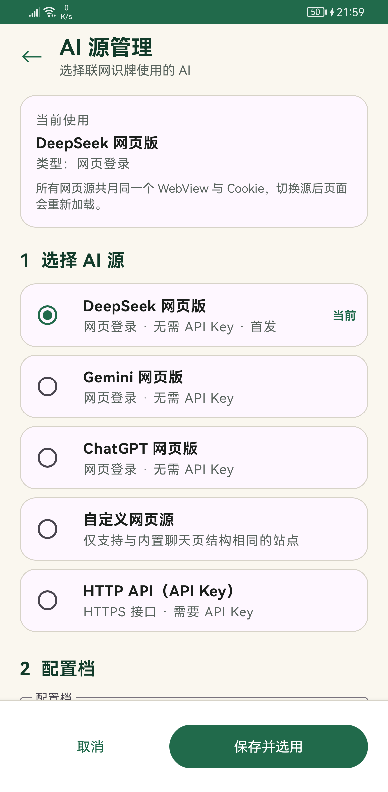

*图 8　AI 源管理：五类源、当前标记、配置档与保存入口；网页源共用同一 WebView 与 Cookie。*

下面再用五张图分别说明**网页登录页、网页源表单、API 源表单、字段校验和退出保护**。这些图只展示界面，不包含账号、Cookie 或 API Key。

### 4.1 五类源

| 源 | 传图方式 | 需要 API Key | 说明 |
| --- | --- | --- | --- |
| DeepSeek 网页版 | 应用内 WebView | 否 | 首发源；登录后复用网页会话 |
| Gemini 网页版 | 应用内 WebView | 否 | 用 Google 账号在应用内登录 |
| ChatGPT 网页版 | 应用内 WebView | 否 | 登录后使用网页附件额度 |
| 自定义网页源 | 应用内 WebView | 否 | 仅支持与内置聊天页结构相同的站点 |
| HTTP API | HTTPS 请求 | 是 | Gemini `generateContent`、OpenAI Responses / Chat Completions |

网页源**完全隐藏**接口地址、模型和 API Key 字段；HTTP API 源则隐藏网页登录按钮，避免填错位置。

### 4.2 配置网页源并登录

1. 在「1 选择 AI 源」点选目标源（如 DeepSeek 网页版）。
2. 在「2 配置档」确认使用哪套配置；首次使用为默认配置。
3. 填写 **名称**（最多 40 字）与 **首页 URL**，必须以 `https://` 开头。
4. 点 **保存并选用**。
5. 点 **网页登录 / 切换账号**（处于需要登录状态时按钮写作「打开网页登录」），在独立的全屏网页中完成登录；返回后 Cookie 由应用保留。
6. 回到本页点 **重新检查**，状态变为「网页可用」即可回主界面识图。

状态含义：

| 状态 | 处理 |
| --- | --- |
| 网页可用 | 可以联网识图 |
| 需要登录 | 点「打开网页登录」完成登录 |
| 页面暂不可用（原因） | 点「重新检查」或检查网络/页面是否改版 |
| 检测中… | 等待只读健康检查结束 |
| 未保存 / 未选用 | 先保存并选用，才能检查或登录 |

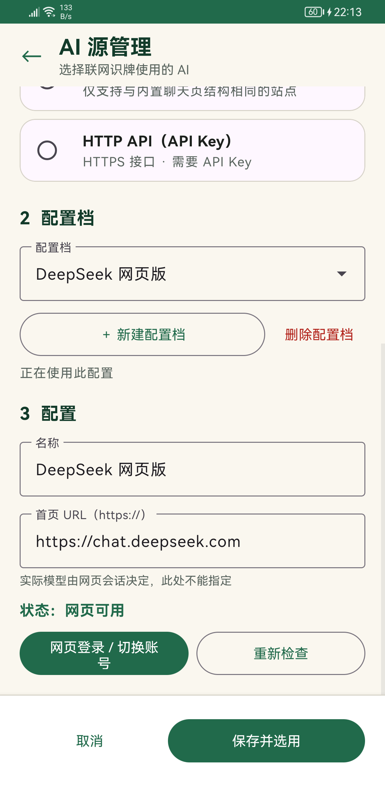

*图 9　网页源配置：名称、首页 URL、健康状态、登录与重新检查在同一页；底部「保存并选用」固定。*

看图时注意三点：

- **保存并选用** 是配置生效的唯一动作。只修改字段不会切换主界面正在使用的源；保存成功后页面自动返回。
- 健康状态只针对**当前激活**的网页配置。图中 DeepSeek 显示「网页可用」，因此登录按钮写作「网页登录 / 切换账号」；即使页面可用，仍保留登录入口，方便换号。
- 非激活配置会显示「未选用（当前使用「…」）」，此时不会为了让预览生效而导航共享 WebView，也不会执行健康检查。


*图 10　网页登录页：全屏网页 + 返回/重新加载；标题栏提示登录完成后返回会自动复查。*

登录页的几点说明：

- 这是应用内的全屏 WebView，不是系统浏览器：只有返回、页面标题和重新加载，没有地址栏、诊断按钮或日志。
- 如果该服务已经登录，会直接进入服务首页（如图中的 DeepSeek 页面）；未登录或需要换号时，使用页面内的账号入口完成登录。
- 返回 AI 源管理页后会自动重新检查一次；登录态由共享 WebView 的 Cookie 保留，不需要额外保存配置。
- 所有网页源共用同一份 Cookie，切换网页源时页面会重新加载，可能出现另一个服务的登录页。
- 登录页内容由所选服务商提供，页面样式和入口可能随站点更新而变化。

### 4.3 配置 HTTP API 源

1. 选择 **HTTP API（API Key）**。
2. 填写名称、**接口地址**（必须 HTTPS）、**模型名称**、**API Key**。
3. API Key 通过右侧眼睛图标显示/隐藏，仅以 Android Keystore 加密保存在本机。
4. 点 **保存并选用**。状态显示「配置完整（本页不验证网络连通性）」或具体缺项。

字段错误会显示在对应输入框下方，例如「首页地址必须使用 HTTPS」「接口地址格式不正确」「模型名称不能为空」「API 源必须填写 API Key」。

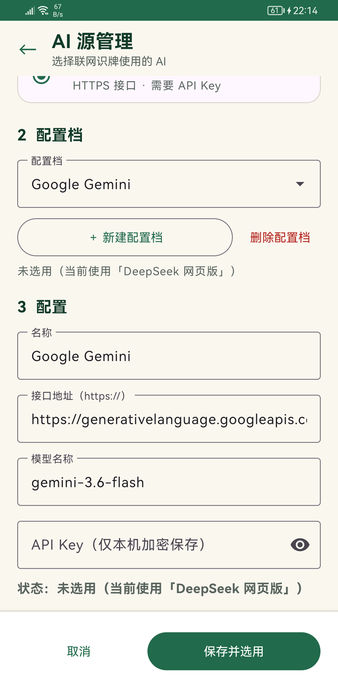

*图 11　HTTP API 配置：接口地址、模型与 API Key；该配置档显示「未选用」，当前仍使用 DeepSeek 网页版。*

- HTTP API 源**没有**「网页登录」按钮，健康区只判断本地配置是否完整，不发起网络请求，因此合法时文案是「配置完整（本页不验证网络连通性）」而不是「已连接」。
- API Key 默认以密码态显示，右侧眼睛图标可临时查看；应用不提供明文回显页面，也不会把 Key 写入日志或页面草稿。
- 图中「未选用（当前使用「DeepSeek 网页版」）」表示只是切换到这份 API 配置查看，并未改变主界面正在使用的源。要真正启用，仍需点「保存并选用」。
- 接口地址较长时输入框只显示前半段，点进输入框可左右滚动查看完整地址。

### 4.4 配置档与未保存修改

- 每个源可保存多套配置档，用下拉框切换；「新建配置档」创建草稿。
- **删除配置档** 需二次确认，确认框会写出将删除的名称；最后一份配置档不可删除，按钮会置灰并说明原因。
- 切换源或配置档前若有未保存修改，会提示「放弃未保存的修改？」。
- 点 **取消** 或系统返回键同样会检查未保存修改，不会静默覆盖已保存配置。

### 4.5 表单校验与退出保护

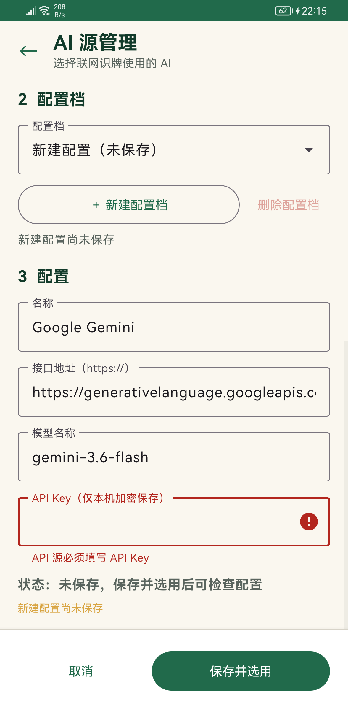

*图 12　字段校验：新建 API 配置未填 Key，点保存后错误落在字段下方，页面保留输入且不写库。*

保存并选用前会先做本地校验；失败时：

1. 对应输入框变红，错误文案显示在字段下方（如「API 源必须填写 API Key」）；
2. 页面自动滚动并聚焦到第一个错误字段；
3. 页面不关闭、输入不丢失，也不会部分保存。

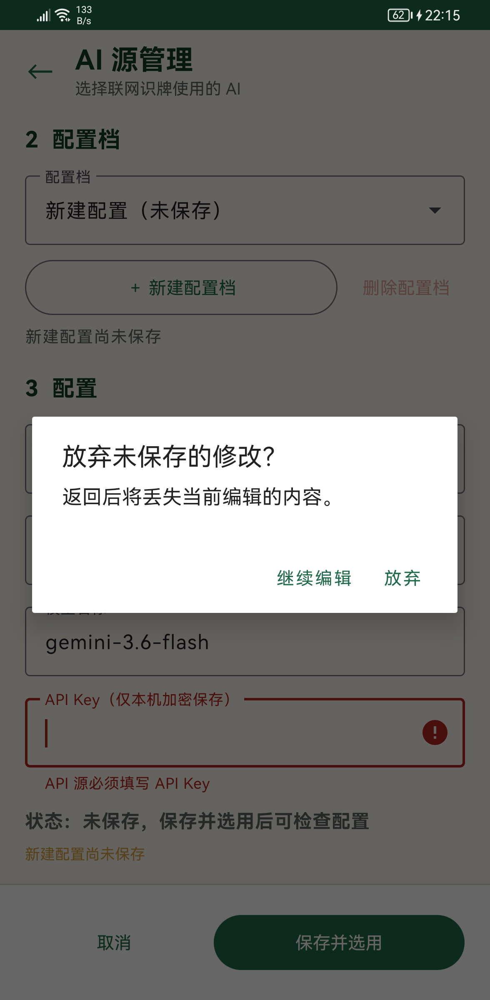

*图 13　退出保护：存在未保存修改时，返回或取消前必须选择「继续编辑」或「放弃」。*

以下动作在存在未保存修改时都会先弹出同一类确认框：

- 左上角返回、系统返回键、底部 **取消**；
- 切换到另一个 AI 源；
- 切换到另一个配置档。

选择 **继续编辑** 回到表单，内容原样保留；选择 **放弃** 才丢弃草稿。放弃不会修改已保存配置，也不会改变当前激活源——这也是本手册截图期间切换查看 API 源后，主界面仍然显示 DeepSeek 网页版的原因。

---

## 5. 常见问题

| 现象 | 原因与处理 |
| --- | --- |
| 识别出的牌少了/多了 | 牌被遮挡、反光或角度过大；用「+ 补录」补牌，点牌面校正，点 `×` 删除误识别 |
| 出现重复牌 | 两副牌中同一点数 + 花色最多 2 张；第 3 张会导致计算失败，按提示删改 |
| 本地识牌失败 | 图片模糊、手牌未完整入镜或牌面风格差异过大；换清晰照片，或用「+ 补录」逐张录入 |
| 联网识图提示需要登录 | 点「登录」完成网页登录；登录后回主界面会自动复查 |
| 联网识图提示页面不可用 | 页面结构变化、网络异常或站点维护；点「重新检查」，或换一个 AI 源 |
| 提示回答超时/解析失败 | 模型未在时限内给出可解析结果；重试，或改用其他源/手动核对 |
| 提示上传额度已用尽 | 网页账号的附件额度用完；换账号/源，或等待额度恢复 |
| HTTP API 提示缺少 Key | 在 AI 源管理中补填 API Key 并「保存并选用」 |
| 计算失败：同一张牌最多出现 2 次 | 手牌不合法，删除多余重复牌后重算 |
| 评级显示「待标定」 | 10～12 张或 19～26 张暂无阈值依据；SPI 仍有效，只是不给等级 |
| 显示「近似最优」 | 15 秒内未完成穷举；结果是完整合法的近似解，可继续使用或手工调整 |
| 结果显示「需要重新计算」 | 手牌或级牌已改变；点「重新计算」后再进入手工拆牌 |
| 找不到「手工拆牌」 | 只有 2～27 张才显示；1 张牌或计算失败时隐藏 |
| 拆牌图按钮不可点 | 需要 27 张手牌且存在有效结果；不足 27 张只能看文字明细 |
| 保存图片失败 | 检查相册/存储权限与剩余空间；失败不会清空当前结果 |

---

## 6. 隐私与网络

- **本地识牌、拆牌、评分全部离线**，不上传图片。
- 只有主动点「联网识图」时，当前图片才会发送到所选 AI 源；网页源受对应服务商的条款与隐私政策约束。
- 网页登录态只保存在应用内的 WebView Cookie；HTTP API Key 用 Android Keystore 加密后仅存本机。
- 接口地址必须是 `https://`；WebView 关闭文件/内容访问与表单保存，混合内容策略为禁止。
- 仓库与安装包中不含任何真实密钥。

---

## 7. 术语表

| 术语 | 含义 |
| --- | --- |
| 级牌 | 本局打到几，2～A 之一；影响牌型取值与红心配 |
| 红心配 | 红桃级牌可替代普通牌参与组合（旧称「逢人配」）；不能替代大小王 |
| 牌型分值 `F` | 单组牌的量化分；普通牌型上限 191，最小四炸 192，火箭 1000 |
| 控制力系数 `α` | 炸弹、同花顺、火箭、单张大王、单张级牌为 1.15，其余为 1.00 |
| `T_plan` | 当前拆牌方案的出牌轮数 |
| `T_max(N)` | N 张手牌的理论最少轮数，用于 NSPI 归一化 |
| `SPI` | 控制加权和扣除散牌惩罚后，除以计划轮数 |
| `NSPI` | `SPI ÷ T_max(N) × 100` |
| 散牌惩罚 `P` | `15 ×` 孤立单张/小对子组数，1～27 张统一适用 |
| 控制覆盖比 `R` | 残局中 `N_control ÷ (T_plan − 1)`，衡量控制单元能否覆盖再次夺权次数 |
| 阶段 | 19～27 开局/前中局、10～18 中局、1～9 残局 |

---

## 8. 截图清单

| 文件 | 内容 |
| --- | --- |
| `pic/01-home.png` | 主界面空状态（01 输入 / 02 识别） |
| `pic/02-random-hand.png` | 随机生成 27 张与本地识牌完成 |
| `pic/03-hand-input.png` | 27 张核对区、级牌与计算按钮 |
| `pic/04-result.png` | 综合牌力结果卡 |
| `pic/05-breakdown.png` | 展开后的逐组拆牌明细 |
| `pic/06-meld-adjust.png` | 手工拆牌双列对照 |
| `pic/07-ai-settings.png` | AI 源管理页 |
| `pic/08-edit-card.png` | 校正扑克牌对话框 |
| `pic/09-ai-web-config.png` | 网页源配置、健康状态与登录入口 |
| `pic/10-ai-web-login.png` | 应用内网页登录页 |
| `pic/11-ai-api-form.png` | HTTP API 源表单与「未选用」状态 |
| `pic/12-ai-validation.png` | API Key 缺失的字段校验 |
| `pic/13-ai-unsaved.png` | 未保存修改的退出确认 |

截图取自 LIO-N29 上的一次真实会话（随机 27 张手牌 + DeepSeek 网页版配置），界面文案随版本可能微调，以应用内实际显示为准。

---

## 9. 相关文档

- [掼蛋牌型量化评分方案](./掼蛋牌型量化评分方案.md)（V4.2，牌型分值权威）
- [手牌综合牌力评估方法](./手牌综合牌力评估方法.md)（SPI / NSPI / 评级权威）
- [UI 设计说明](./ui_design.md)
- [手工拆牌设计](./patterns_design.md)
- [AI 源配置说明](./ai_configure.md)
